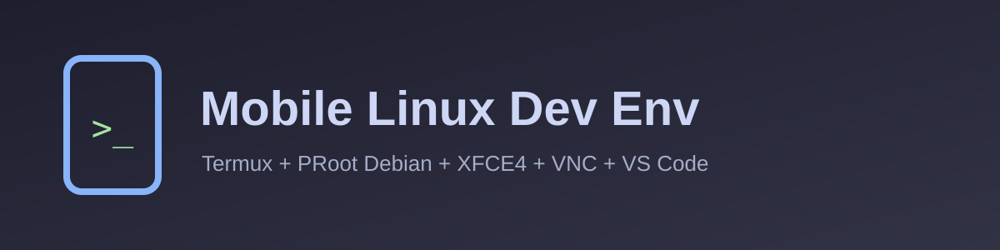

<div align="center">



# Mobile Linux Dev Env

**A lightweight, secure Linux desktop + web-dev toolkit for your Android phone.**
Termux · PRoot Debian · XFCE4 · TigerVNC · VS Code · AI helper

[](https://github.com/YOUR_GITHUB_USERNAME/mobile-linux-dev-env/actions/workflows/shellcheck.yml)
[](LICENSE)
-3DDC84)


</div>

---

## ✨ What is this?

A **zero-friction, one-command installer** that turns a phone into a real coding workstation:
a full Linux desktop (viewed through a VNC app) with **VS Code, Chromium, Firefox, Node.js, Python,
PHP and Git**, tuned to run on **4 GB / Unisoc-class devices** and to scale up on flagships.

## 🚀 Features

| | Feature | Details |
|---|---------|---------|
| 🪶 | **Lightweight** | Minimal XFCE4 (no compositing on low/mid), 16-bit colour on low-end, tuned browsers |
| 🧠 | **Auto-profiles** | `low` / `mid` / `high` chosen from your RAM (override any time) |
| 🔒 | **Secure by default** | VNC & VS Code on `127.0.0.1` only, runtime password prompts, `600/700` permissions |
| 🧑‍💻 | **Web-dev ready** | VS Code (code-server) + Prettier, ESLint, Tailwind, Python, PHP, Live Server |
| 🤖 | **AI helper** | `ai` command explains errors and answers coding questions from the terminal |
| 🧰 | **One control command** | `mld start / stop / status / passwd / resolution / update / uninstall` |
| 📦 | **Open-source quality** | ShellCheck CI, tagged releases, MIT license, `SECURITY.md` |

## 📋 Requirements

| Item | Requirement |
|------|-------------|
| Android | 8.0+ (Android 12+: see the *phantom process* note below) |
| Termux | Latest from **F-Droid** or **GitHub** (the Play Store build is outdated) |
| Storage | **5 GB free** recommended (3 GB minimum) |
| RAM | 3 GB+ (4 GB comfortable) |
| VNC app | RealVNC Viewer, bVNC or similar |
| proot-distro | Installed automatically (works with both the classic v4 and the newer v5 releases) |

## ⚡ Quick start

**1. Install (one line, inside Termux):**

```bash
pkg install -y curl && curl -fsSL https://raw.githubusercontent.com/YOUR_GITHUB_USERNAME/mobile-linux-dev-env/main/scripts/install.sh | bash
```

Prefer to read the code first? Clone and run it:

```bash
pkg install -y git
git clone https://github.com/YOUR_GITHUB_USERNAME/mobile-linux-dev-env.git
cd mobile-linux-dev-env && bash scripts/install.sh
```

Choose a VNC password when asked. Installation takes roughly 10-30 minutes.

**2. Start the desktop:**

```bash
mld start
```

**3. Connect:** open your VNC viewer app and connect to **`localhost:5901`**.

## 🖥️ Daily use

| Command | What it does |
|---------|--------------|
| `mld start` / `mld stop` / `mld restart` | Control the desktop |
| `mld status` | Show whether it is running |
| `mld passwd` | Change the VNC password |
| `mld resolution 1280x720` | Change screen size (then `mld restart`) |
| `mld shell` / `mld root` | Terminal inside Linux (user / root) |
| `mld ai` | AI coding helper (see below) |
| `mld code-password` | Show the VS Code login password |
| `mld autostart on` | Start at boot (needs the Termux:Boot app) |
| `mld update` | Pull the latest version and re-apply configs |
| `mld uninstall` | Remove everything |

Tip: switch the VNC viewer to **landscape** and use a Bluetooth keyboard for the best experience.

## 🧩 What gets installed

| Category | Software |
|----------|----------|
| Desktop | XFCE4 (session, panel, Thunar, terminal, Mousepad, task manager), TigerVNC |
| Browsers | Chromium (low-memory flags), Firefox ESR (tuned policies) |
| Editor | code-server (VS Code in an app window) with HTML/CSS/JS/Tailwind/Python/PHP extensions |
| Runtimes | Node.js + npm, Python 3 + pip + venv, PHP CLI, Git, curl, wget |
| Helper | `ai-assistant` CLI (Anthropic or any OpenAI-compatible endpoint) |

A starter site is created in `~/projects/hello-web`.

## 📊 Performance profiles

| Profile | Typical RAM | Resolution | Colour | Compositing | VS Code heap |
|---------|-------------|------------|--------|-------------|--------------|
| `low`  | ≤ 4 GB (e.g. Unisoc T606) | 1280×720 | 16-bit | off | 384 MB |
| `mid`  | ~6 GB | 1600×900 | 24-bit | off | 768 MB |
| `high` | 8 GB+ | 1920×1080 | 24-bit | on | 2048 MB |

Force a profile: `bash scripts/install.sh --profile low` (or `MLD_PROFILE=low` in `.env`).

## 🤖 AI coding helper

```bash
ai configure              # pick provider/model, enter your API key (hidden, stored with mode 600)
ai ask "why is my flexbox not centering?"
ai chat                   # interactive session
ai fix npm run build      # runs the command, explains the error and the fix
```

The key is never hardcoded or committed. Providers: `anthropic`, or `openai` for any
OpenAI-compatible endpoint (including local servers such as Ollama on `http://127.0.0.1`).

## 🗂️ Project structure

```text
mobile-linux-dev-env/
├── .github/workflows/      shellcheck.yml, release.yml
├── assets/                 banners/ and logos/
├── configs/
│   ├── chromium/flags.conf
│   ├── profiles/           low.conf, mid.conf, high.conf
│   ├── vnc/xstartup
│   └── vscode/             settings.json, extensions.txt
├── scripts/
│   ├── install.sh          master installer (Termux)
│   ├── setup-vnc.sh        VNC + desktop setup/runtime (guest)
│   ├── ai-assistant.sh     built-in AI helper
│   ├── mld.sh              the `mld` control command
│   ├── uninstall.sh
│   ├── lib/common.sh       logging, spinner, arch/RAM detection, traps
│   └── guest/              provision.sh, install-apps.sh, mld-code.sh, sync-in.sh
├── .env.example  .gitignore  .gitattributes
└── LICENSE  README.md  SECURITY.md
```

## 🛠️ Troubleshooting

| Problem | Fix |
|---------|-----|
| VNC viewer cannot connect | Run `mld status`; connect to `localhost:5901` (not your Wi-Fi IP). Check `~/.mld/run/desktop.log`. |
| Grey screen / no panel | `mld restart`. Still broken? `mld shell` then `rm -rf ~/.config/xfce4` and restart. |
| Desktop dies in the background (Android 12+) | Run `termux-wake-lock`; enable *Developer options → Disable child process restrictions*, or via ADB: `adb shell device_config put activity_manager max_phantom_processes 2147483647`. |
| `Xtigervnc exited early` | `mld stop`, then `mld start`. Stale locks are cleaned automatically. |
| Chromium crashes or is slow | Use Firefox for heavy pages, close tabs, switch to `low` profile, reduce resolution with `mld resolution`. |
| VS Code asks for a password | Press **Ctrl+V** (it is copied automatically) or run `mld code-password`. |
| `apt` errors inside Linux | `mld root`, then `apt-get update`. Re-run the installer to repair. |
| Not enough storage | Free 5 GB, then re-run the installer (it resumes). |
| `The Debian container was not created` | Run `proot-distro install debian` to see the real error. The image comes from Docker Hub; if you hit a rate limit, wait a while or switch networks, then re-run the installer. |
| Installer looks stuck | The spinner shows elapsed time and the last log line. For full output re-run with `bash scripts/install.sh --verbose`, or open a second Termux session and run `tail -f ~/.cache/mld/mld.log`. Steps are time-limited and stop with an error instead of hanging forever. |
| Installer stopped half-way | Simply run `bash scripts/install.sh` again - finished steps (including an existing Debian container) are reused. |
| Installer log | `~/.cache/mld/mld.log` in Termux. |

## 🔐 Security notice

* VNC and VS Code listen on **localhost only**; do not expose them to the internet.
* Browsers run **without their sandbox** (a PRoot limitation). Use this environment for development
  and trusted sites, not for banking or primary-email logins.
* No secrets live in this repo. Passwords and API keys are prompted at runtime and stored with `600`
  permissions. Read [`SECURITY.md`](SECURITY.md) for the full protocol and how to report issues.
* The one-line installer pipes a script into `bash` - inspect it first if you prefer (clone method above).

## 🧹 Uninstall

```bash
mld uninstall
```

## 🤝 Contributing

1. Fork and create a feature branch.
2. Run `shellcheck -x -S warning scripts/*.sh scripts/*/*.sh`.
3. Open a pull request describing the change and the device you tested on.

## 📄 License

Released under the [MIT License](LICENSE).
